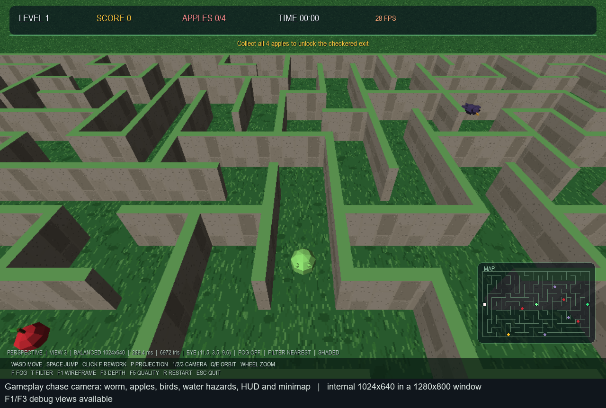

# Worm's Garden Adventure 3D

Computer Graphics Programming (GEIAL31L-B2a) - Labs 10 & 11 (final assignment,
20 % of the course grade).

A guided 2D-to-3D conversion of the supplied Pygame game `Start2Dto3D.py`,
written in Python with **NumPy, Pillow and Pygame only**. The whole 3D
pipeline - vectors and 4x4 transforms, camera basis, perspective and
orthographic projection, near-plane clipping, triangle rasterization,
Z-buffer visibility, flat lighting, texture sampling, depth fog - is our own
code. No game engine and no high-level 3D renderer is used; Pygame only
provides the window, input, timing, framebuffer blit and the 2D HUD.



## Environment (versions tested)

| Tool | Version |
|---|---|
| Python | 3.12.0 (project virtual environment `.venv`) |
| NumPy | 2.5.5 |
| Pillow | 13.0.0 |
| Pygame | 2.6.1 (SDL 2.28.4) |
| Numba | 0.68.1 (optional CPU JIT, **not** required) |
| python-docx | 1.2.0 (build-time, rebuilds the report) |
| imageio / imageio-ffmpeg | 2.38.2 / 0.8.1 (build-time, rebuilds the demo video) |

## Install

```bash
python -m venv .venv
# Windows:
.venv\Scripts\activate
# macOS / Linux:
# source .venv/bin/activate

pip install -r requirements.txt
```

`pip install numba` is optional (handbook p.30): it JIT-compiles the fragment
loop and makes the game noticeably faster. Without Numba the renderer falls
back to a pure NumPy/Python path that is correct but slower.

## Run

```bash
python main.py
```

The original supplied 2D reference is kept in `reference/Start2Dto3D.py` for
comparison; `python first_cube.py` runs the Appendix E wireframe cube demo.

## Controls

| Key | Effect |
|---|---|
| WASD / arrows | Move the worm on the X/Z ground plane |
| SPACE | Vertical jump (gravity acts on world Y) |
| P | Toggle perspective / orthographic projection |
| 1 / 2 / 3 | Camera preset: elevated overview / side / third-person follow |
| Q / E | Orbit the camera around its target |
| Mouse wheel | Dolly the camera in and out (clamped) |
| F5 | Cycle render resolution: FAST / BALANCED / HIGH / NATIVE |
| F | Cycle depth fog: OFF -> LIGHT -> HEAVY (extension 1) |
| T | Toggle nearest / bilinear texture sampling (extension 2) |
| F1 | Wireframe debug view (projected triangle edges) |
| F3 | Depth-buffer debug view (banded depth image) |
| Left mouse click | Ray-cast the pixel to the ground plane, firework burst there |
| R | Restart the run (level 1, score 0, particles cleared) |
| ESC / window close | Quit |

The HUD shows level, score, apples, time, FPS, the active projection, camera
preset, the **real internal framebuffer size**, render milliseconds, triangle
count, camera eye coordinates, fog mode, filter mode and debug mode, plus a
bottom-right corridor minimap (walls, apples, birds, worm, start, exit).

## Project layout

| File | Responsibility |
|---|---|
| `main.py` | Pygame loop, input, camera presets, frame timing, HUD, minimap |
| `maze.py` | Procedural maze generation, neighbours, cell/world conversion |
| `game.py` | Levels, apples, birds, scoring, timer, finish rules |
| `geometry.py` | Cube/box/ground/lawn meshes, UV mapping, worm, apple, bird, flags |
| `transforms.py` | 4x4 matrices (translate, rotate Y/Z, scale), vector helpers |
| `camera.py` | Camera basis, perspective/orthographic projection, near clip, pixel ray |
| `renderer.py` | Batched triangle submission, Z-buffer, lighting, textures, fog, wireframe/depth debug |
| `renderer_jit.py` | Optional Numba fragment loop (and pure-Python fallback flag) |
| `materials.py` | Materials, procedural Pillow textures, nearest/bilinear samplers, shading |
| `physics.py` | Movement, wall slide, jump, height-aware water/bird/apple tests |
| `particles.py` | 3D sparks and fireworks, gravity, damping, bounded count |
| `first_cube.py` | Appendix E wireframe unit-cube orbit demo |
| `benchmark.py` | Offscreen benchmark -> `results/benchmark.json` / `.txt` |
| `make_screenshots.py` | Regenerates every captioned evidence image in `screenshots/` |
| `tools/build_report.py` | Rebuilds `report/Worms_Garden_Adventure_3D_Report.docx` |
| `tools/make_demo_video.py` | Renders `report/demo_video.mp4` (2:20, 1280x720, 24 fps) |
| `tests/` | 12 self-contained numerical and gameplay checks |
| `screenshots/` | Labelled evidence images (19 files) |
| `results/` | Measured performance table |
| `report/` | Technical report (DOCX, 10 pages) and demo recording |

## Tests

Run each file from the project root with the project interpreter (no window is
needed):

```bash
.venv\Scripts\python.exe tests\test_maze.py
.venv\Scripts\python.exe tests\test_transforms.py
.venv\Scripts\python.exe tests\test_geometry.py
.venv\Scripts\python.exe tests\test_camera.py
.venv\Scripts\python.exe tests\test_renderer.py
.venv\Scripts\python.exe tests\test_maze_world.py
.venv\Scripts\python.exe tests\test_materials.py
.venv\Scripts\python.exe tests\test_physics.py
.venv\Scripts\python.exe tests\test_game.py
.venv\Scripts\python.exe tests\test_particles.py
.venv\Scripts\python.exe tests\test_extensions.py
.venv\Scripts\python.exe tests\test_resize.py
```

Performance benchmark (writes `results/benchmark.txt` and `benchmark.json`):

```bash
.venv\Scripts\python.exe benchmark.py
```

Evidence screenshots (writes `screenshots/`, needs no display):

```bash
.venv\Scripts\python.exe make_screenshots.py
```

## Measured performance

Offscreen benchmark, same maze seed / camera / scene, 12 frames per preset
after one warm-up frame (1280x800 window, 6972 triangles submitted):

| Preset | Framebuffer | Pixels | Mean render ms | FPS |
|---|---|---|---|---|
| FAST | 672x420 | 282,240 | 12.35 | 81.5 |
| BALANCED (default) | 1024x640 | 655,360 | 18.58 | 54.9 |
| HIGH | 1600x1000 | 1,600,000 | 34.41 | 29.0 |
| NATIVE | 1280x800 | 1,024,000 | 24.52 | 41.0 |

The cost now scales with the number of pixels (per-fragment shading), not with
triangle count, which is what the batching work was for. The third-person
follow camera costs a little more because geometry near the eye crosses the
near plane and takes the Sutherland-Hodgman path (~220 triangles per frame).
Numba is optional; without it the NumPy fallback is several times slower.

## Extensions (Part B)

### 1. Atmospheric depth fog (graphics)

Per-fragment blend toward the sky colour by camera depth:
`t = clamp((z - near) / (far - near), 0, 1)`, `C = C_frag*(1 - t) + C_fog*t`,
applied after lighting and texture sampling and before the depth write. The
range is derived from the camera distance to the maze centre
(`far = clamp(1.6*d, 10, 48)`, `near = 0.45*far`) so it works from the overview
and from inside the corridors. **F** cycles OFF -> LIGHT -> HEAVY (HEAVY
shrinks the range to 72 %). Before/after: `screenshots/09_fog_off.png` and
`10_fog_on.png`; numeric check in `tests/test_extensions.py`.

### 2. Bilinear texture filtering (image processing)

The Part A sampler is nearest-neighbour. The extension blends the four
neighbouring texels at fractional UV coordinates
(`c00*(1-fx)+c10*fx`, `c01*(1-fx)+c11*fx`, then `*(1-fy)+*fy`), so magnified
textures soften instead of showing hard blocks. **T** toggles it. Same 3D
patch: `screenshots/11_filter_nearest.png` vs `12_filter_bilinear.png`; pure
2D magnification: `13_tex_nearest_zoom.png` vs `14_tex_bilinear_zoom.png`.
Limitation: no mipmaps, so minified distant textures still alias.

## Evidence and deliverables

| Item | Location |
|---|---|
| Technical report, 10 pages (DOCX) | `report/Worms_Garden_Adventure_3D_Report.docx` |
| Demo recording, 2:20, 1280x720, 24 fps | `report/demo_video.mp4` |
| Screenshots, 19 labelled images | `screenshots/` |
| Performance table | `results/benchmark.txt`, `results/benchmark.json` |
| Unit/integration tests | `tests/` |

Screenshot index: 01 wireframe cube, 02 perspective, 03 orthographic,
04 occlusion, 05 textured close view, 06 gameplay with HUD, 07 FAST / 08 HIGH
resolution, 09/10 fog off/heavy, 11/12 nearest/bilinear, 13/14 texture zoom,
15 F1 wireframe, 16 F3 depth, 17/18 wide/narrow window resize, 19 near-plane safety.

## External code / assets

- `reference/Start2Dto3D.py` is the 2D game supplied by the course; its maze
  generation, placement rules and scoring logic are reused and adapted to 3D.
- All textures (`grass`, `stone`) are generated procedurally at runtime with
  Pillow from fixed random seeds; no image, sound, font or model asset is
  bundled, and the only font used is the system font via
  `pygame.font.SysFont("Arial", ...)` (with a Pillow default-font fallback in
  the screenshot tooling).
- Runtime dependencies: NumPy, Pillow, Pygame (see `requirements.txt`).
  Optional: Numba. Build-time only: python-docx, imageio, imageio-ffmpeg.
- No game engine, GPU renderer or third-party 3D mesh library is used.


